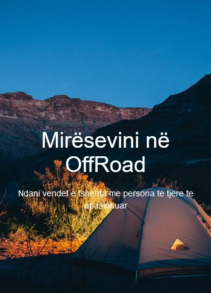

# OffRoad

A site for sharing off-road spots, with an Albanian-language interface. Users post locations with a photo and a map, comment on each other's posts and reset forgotten passwords by email. It started from Colt Steele's YelpCamp course project and was extended from there.

**Live:** no longer hosted.



## Features

- Sign up, log in and log out with Passport (local strategy), plus an optional admin role set with an admin code at registration
- Create, edit and delete posts with an image upload (stored on Cloudinary), a price and a location
- Locations are geocoded with LocationIQ and shown on a Google Map on each post
- Comments on posts, editable and deletable by their author
- Search posts by name
- User profile pages with an editable profile
- Password reset by email through Nodemailer (Gmail)
- Ownership checks on edit and delete, and Helmet security headers

## Stack

- [Node.js](https://nodejs.org) with [Express 4](https://expressjs.com) and [EJS](https://ejs.co) templates
- [MongoDB](https://www.mongodb.com) with [Mongoose 5](https://mongoosejs.com)
- [Passport](https://www.passportjs.org) and passport-local-mongoose for auth
- [Cloudinary](https://cloudinary.com) for images, LocationIQ via node-geocoder, Google Maps JavaScript API

## Project structure

```
offroad/
├── app.js          # Express setup, sessions, Passport, route mounting
├── models/         # Campground (post), Comment, User
├── routes/         # posts, comments, users, auth, password reset
├── middleware/     # login and ownership checks
├── views/          # EJS pages and partials
└── public/         # styles, scripts and images
```

## Run locally

You need Node.js and a MongoDB instance.

```sh
npm install
npm start
```

Set these environment variables (a `.env` file is read with dotenv):

| Variable | Used for |
| --- | --- |
| `DATABASEURL` | MongoDB connection string (falls back to `mongodb://localhost/yelp_camp_v13`) |
| `SESSIONSECRET` | Express session secret |
| `CLOUDINARY_CLOUD_NAME`, `CLOUDINARY_API_KEY`, `CLOUDINARY_API_SECRET` | Image uploads (`APISECRET` still works for the secret) |
| `LOCATIONIQ_API_KEY` | Geocoding post locations |
| `GOOGLE_MAPS_API_KEY` | The map on each post page |
| `ADMINCODE` | Code that gives a new account the admin role |
| `PASSWORD` | Password for the Gmail account that sends reset emails |
| `PORT`, `IP` | Address the server listens on |

`.env.example` lists them all.

## Deploy

It ran as a single Node process on Heroku and later Render, with MongoDB hosted separately. Any Node host works: set the variables above and run `npm start`.

## License

[Apache 2.0](LICENSE)
